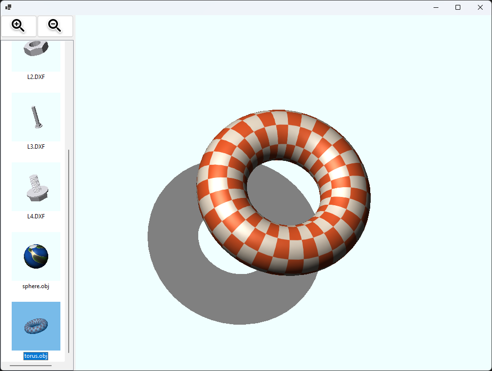

Software render on C# (WinForms, GDI+)

[](https://github.com/sponsors/makarov-mm)
[](LICENSE)

[](https://www.linkedin.com/in/makarov-mm/)
[](https://www.threads.net/@m.m.makarov)
[](https://www.instagram.com/m.m.makarov/)


Features:
- Barycentric triangle rasterizer with a Z-buffer and per-pixel interpolation of depth, UV and normals; edge functions are stepped incrementally along each scanline
- Texture mapping: bilinear filtering, repeat wrapping (PNG/JPG/BMP via GDI+)
- Per-pixel lighting: Lambert diffuse + Blinn-Phong specular + ambient, smooth (Phong) shading for models with vertex normals, flat shading for CAD meshes
- Wavefront OBJ/MTL loader (v/vt/vn, negative indices, n-gon fan triangulation, map_Kd); smooth vertex normals are computed automatically when the file has none
- DXF loader: MESH (AcDbSubDMesh, faces of any size) and 3DFACE entities
- Flat drop shadow, thumbnails of every model in `Objects/`, per-monitor DPI awareness
- Math on `System.Numerics` (`Vector3`, `Matrix4x4`), no per-pixel allocations; the frame is rendered into an `int[]` colour buffer and blitted into a bitmap once
- Sample textured models included: crate cube, planet sphere, checkered torus

Controls:

| Input | Action |
| --- | --- |
| Left mouse drag | Rotate the model |
| Mouse wheel, zoom buttons, `Q` / `E` | Zoom out / in |
| `W` / `S`, `A` / `D` | Tilt / turn the model while held |

Build and run (Windows, .NET 11 SDK):

```
cd Sources
dotnet run -c Release
```

Models are picked up from the `Objects` folder next to the executable; drop in any `.obj` (with its `.mtl` and textures) or `.dxf` file.

Layout of `Sources/`:

| File | Role |
| --- | --- |
| `Program.cs`, `MainForm.cs` | WinForms host: thumbnails list, zoom buttons, the view, input |
| `Viewport.cs` | model + rotation + zoom, fitted to a render target, with the drop shadow |
| `Rasterizer.cs` | triangle fill, Z-test, texturing and lighting |
| `RenderTarget.cs` | colour and depth buffers |
| `Mesh.cs`, `Vertex.cs` | triangle list, bounds, flat and smooth normals |
| `Texture.cs`, `TextureIO.cs` | bilinear sampling; GDI+ decoding and the bitmap blit |
| `IModelLoader.cs`, `ObjLoader.cs`, `DxfLoader.cs` | file formats |

Please, visit my page on [https://www.linkedin.com/in/makarov-mm/](https://www.linkedin.com/in/makarov-mm/)




## License

MIT License

Copyright (c) 2026 Mykhailo Makarov

Permission is hereby granted, free of charge, to any person obtaining a copy
of this software and associated documentation files (the "Software"), to deal
in the Software without restriction, including without limitation the rights
to use, copy, modify, merge, publish, distribute, sublicense, and/or sell
copies of the Software, and to permit persons to whom the Software is
furnished to do so, subject to the following conditions:

The above copyright notice and this permission notice shall be included in all
copies or substantial portions of the Software.

THE SOFTWARE IS PROVIDED "AS IS", WITHOUT WARRANTY OF ANY KIND, EXPRESS OR
IMPLIED, INCLUDING BUT NOT LIMITED TO THE WARRANTIES OF MERCHANTABILITY,
FITNESS FOR A PARTICULAR PURPOSE AND NONINFRINGEMENT. IN NO EVENT SHALL THE
AUTHORS OR COPYRIGHT HOLDERS BE LIABLE FOR ANY CLAIM, DAMAGES OR OTHER
LIABILITY, WHETHER IN AN ACTION OF CONTRACT, TORT OR OTHERWISE, ARISING FROM,
OUT OF OR IN CONNECTION WITH THE SOFTWARE OR THE USE OR OTHER DEALINGS IN THE
SOFTWARE.

## Support

If you found this project interesting or useful, you can support my work:

[](https://github.com/sponsors/makarov-mm)
